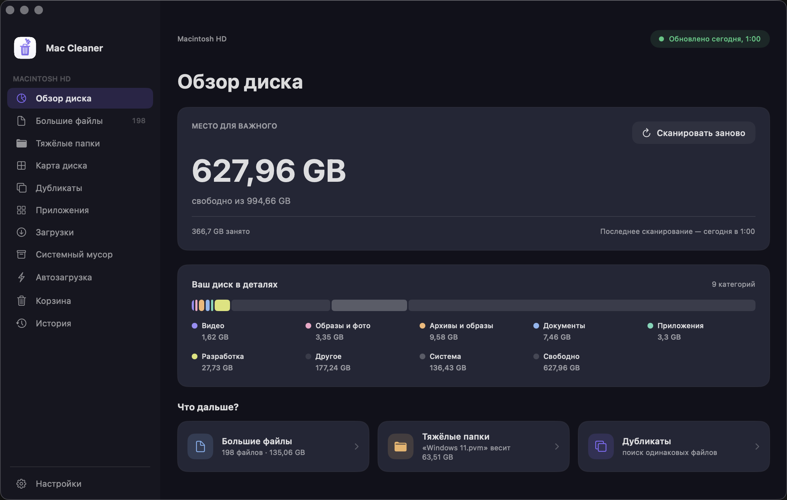
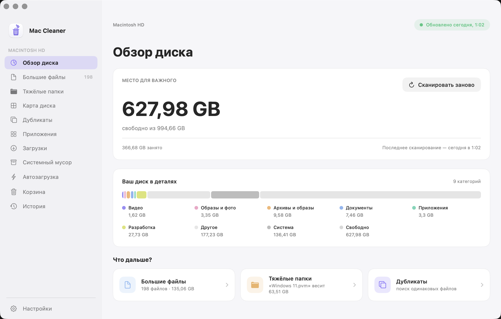
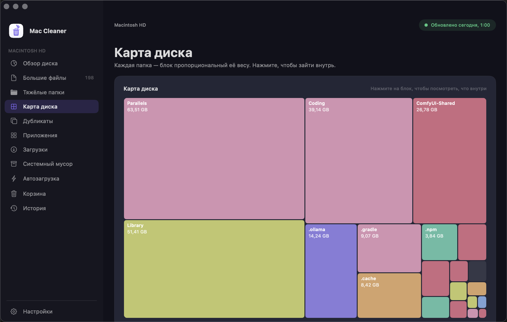

<div align="center">
  
  <h1>Mac Cleaner</h1>
  <p>A native macOS disk cleaner built with SwiftUI.<br>No telemetry, no subscriptions, no "Mac boosting" — just facts and control.</p>

  <p>
    <a href="https://github.com/MrPacmann/MacCleaner/releases/latest"></a>
    
    
    <a href="LICENSE"></a>
  </p>

  <p><b>English</b> · <a href="README.ru.md">Русский</a> · <a href="ROADMAP.md">Roadmap</a></p>
</div>

---

## Screenshots

<p align="center">
  
  
</p>
<p align="center">
  
  
</p>

## Features

- **Disk Overview** — space usage by category, drill down into the files of each category
- **Disk Map** — interactive folder treemap, DaisyDisk-style
- **Large Files & Heavy Folders** — 50 MB+ files and 100 MB+ folders, with search and sorting
- **Duplicates** — exact content comparison (SHA-256)
- **Applications** — uninstall together with leftovers (caches, preferences, containers) + finds "orphans" from long-removed apps
- **System Junk** — caches, logs, Xcode/DerivedData, package managers, node_modules, project build dirs (dist, .next, target, build, Pods, venv), Docker, iPhone/iPad backups, Mail attachments
- **Login Items** — user agents, including broken ones (the app is already gone)
- **Downloads** — files older than 30 days
- **Trash** — browse and empty
- **History** — cleanup log, free-space chart and "what grew since last scan"
- **Menu Bar** — free disk space always in sight (optional)
- **Shortcuts** — "Start scan" and "Empty Trash" actions for Apple Shortcuts and Siri
- **Auto-updates** — the app downloads new versions from GitHub Releases and installs them itself
- **Hotkeys** — ⌘1…⌘0 to jump between sections, ⌘F to search
- Russian and English UI, dark and light themes

## Safety

- Deletion goes **to the Trash only** — everything is one click away from being restored
- No system files, no SIP-protected paths
- All scanning is local; network is used only to check for updates

## Download

Grab the DMG from the [latest release](https://github.com/MrPacmann/MacCleaner/releases/latest), open it and drag MacCleaner to Applications.

### If macOS says it "cannot verify that the file is free of malware"

That's Gatekeeper's standard reaction to a free ad-hoc signature — the app is not notarized by Apple. To get past it:

1. Click **"Done"** in the dialog (not "Move to Trash")
2. Open **System Settings → Privacy & Security**
3. Scroll down — you'll see a note about MacCleaner with an **"Open Anyway"** button
4. Confirm — the app launches, and macOS won't ask again

Or run one command in Terminal after installing to Applications:

```bash
xattr -dr com.apple.quarantine /Applications/MacCleaner.app
```

This is needed **once, at first install**. In-app updates (Settings → Updates) are downloaded by MacCleaner itself and install without this dialog.

After launch, grant **Full Disk Access** (Settings → Permissions inside the app) — otherwise some folders will be invisible to scans.

## Build from Source

Only Xcode Command Line Tools are needed — one script does everything:

```bash
git clone https://github.com/MrPacmann/MacCleaner.git
cd MacCleaner
./build.sh
open build/MacCleaner.app
```

## Tech

SwiftUI · Observation · CryptoKit · Charts · AppIntents · zero external dependencies · macOS 14+

## Author

Stepan Trushin — [github.com/MrPacmann](https://github.com/MrPacmann)
