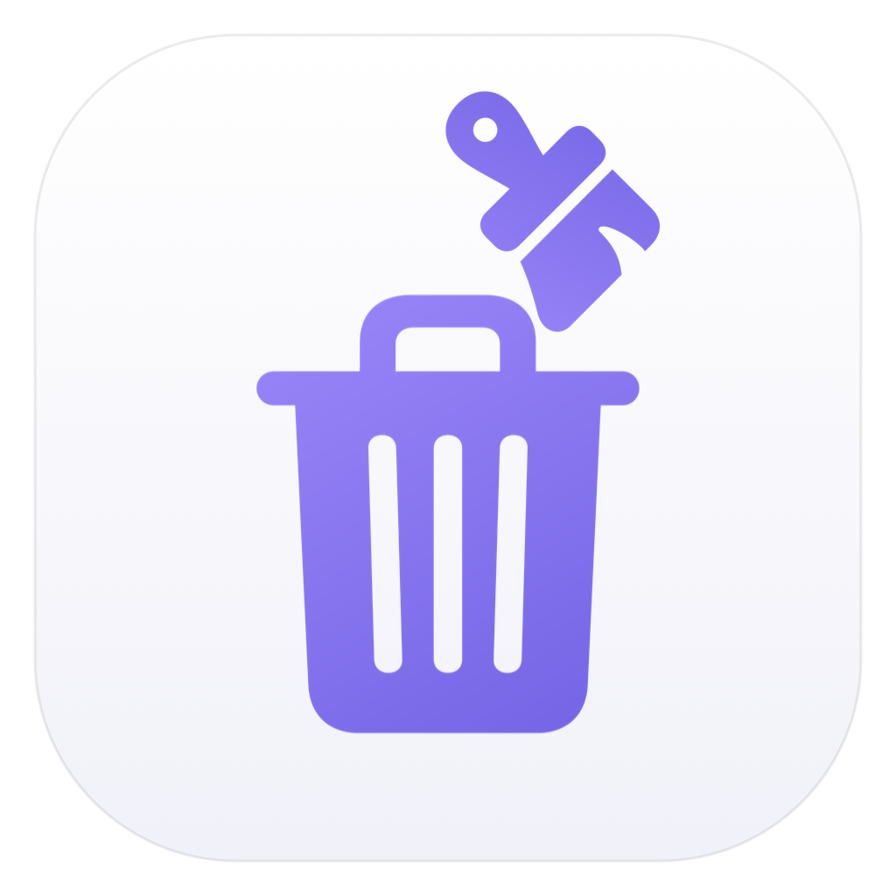

<div align="center">
  
  <h1>Mac Cleaner</h1>
  <p>Нативный очиститель диска для macOS на SwiftUI.<br>Без телеметрии, без подписок, без «ускорения Mac» — только факты и контроль.</p>
</div>

---

## Возможности

- **Обзор диска** — занятое место по категориям с проваливанием в файлы каждой категории
- **Карта диска** — интерактивная treemap папок, как в DaisyDisk
- **Большие файлы и тяжёлые папки** — от 50 МБ и от 100 МБ, с поиском и сортировкой
- **Дубликаты** — точное сравнение по содержимому (SHA-256)
- **Приложения** — удаление вместе с остатками (кэши, настройки, контейнеры) + поиск «сирот» от давно удалённых программ
- **Системный мусор** — кэши, логи, Xcode/DerivedData, пакетные менеджеры, node_modules, сборки проектов (dist, .next, target, build, Pods, venv), Docker, бэкапы iPhone/iPad, вложения почты
- **Автозагрузка** — агенты пользователя, включая битые (программа уже удалена)
- **Загрузки** — файлы старше 30 дней
- **Корзина** — просмотр и очистка
- **История** — что и когда было отправлено в Корзину
- **Обновления** — проверка новых версий через GitHub Releases
- Русский и английский интерфейс, тёмная и светлая темы

## Безопасность

- Удаление — **только в Корзину** (восстановление в один клик)
- Никаких системных файлов и SIP-защищённых путей
- Всё сканирование локально, сеть используется только для проверки обновлений

## Сборка из исходников

Нужны только Xcode Command Line Tools — проект собирается одним скриптом:

```bash
git clone https://github.com/MrPacmann/MacCleaner.git
cd MacCleaner
./build.sh
open build/MacCleaner.app
```

## Готовая сборка

Скачайте `MacCleaner-1.0.dmg` из [последнего релиза](https://github.com/MrPacmann/MacCleaner/releases/latest), откройте его и перетащите MacCleaner в папку Applications.

Приложение подписано ad-hoc, поэтому при первом запуске: правый клик → «Открыть».

После запуска выдайте **Полный доступ к диску** (Настройки → Разрешения внутри приложения), иначе часть папок будет недоступна для сканирования.

## Технологии

SwiftUI · Observation · CryptoKit · без внешних зависимостей · macOS 14+

## Автор

Stepan Trushin — [github.com/MrPacmann](https://github.com/MrPacmann)
