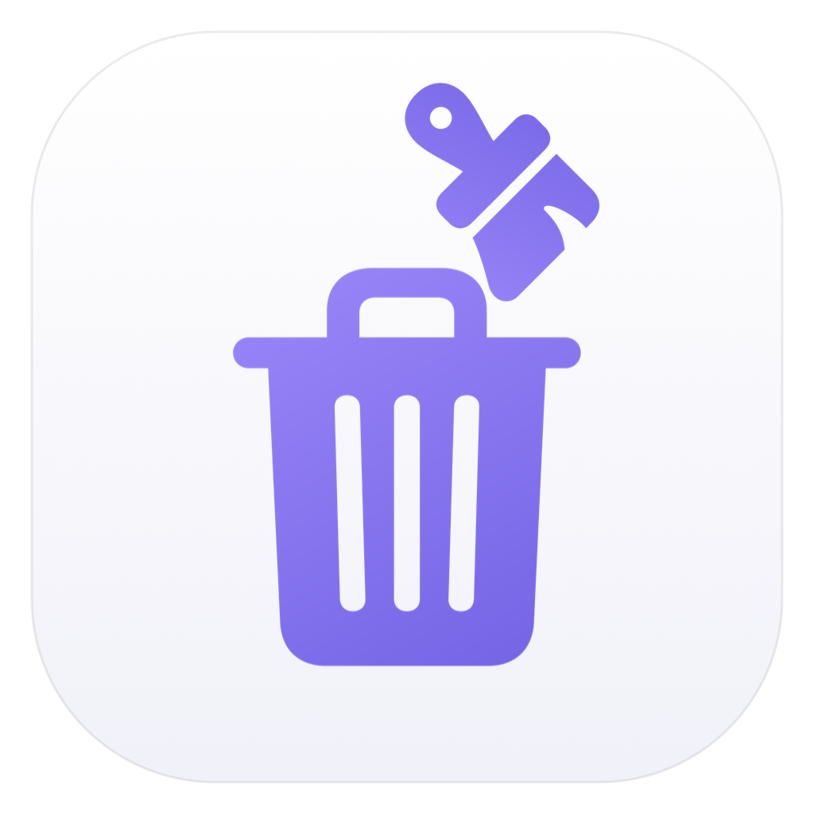
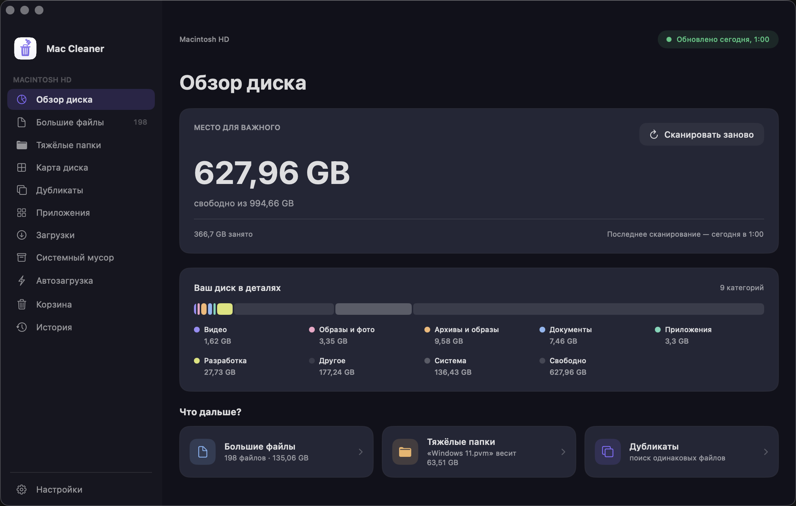
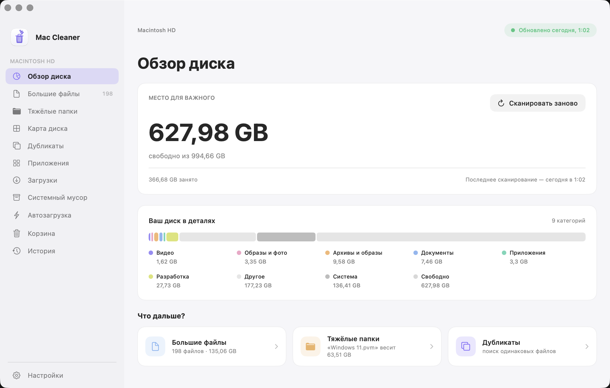
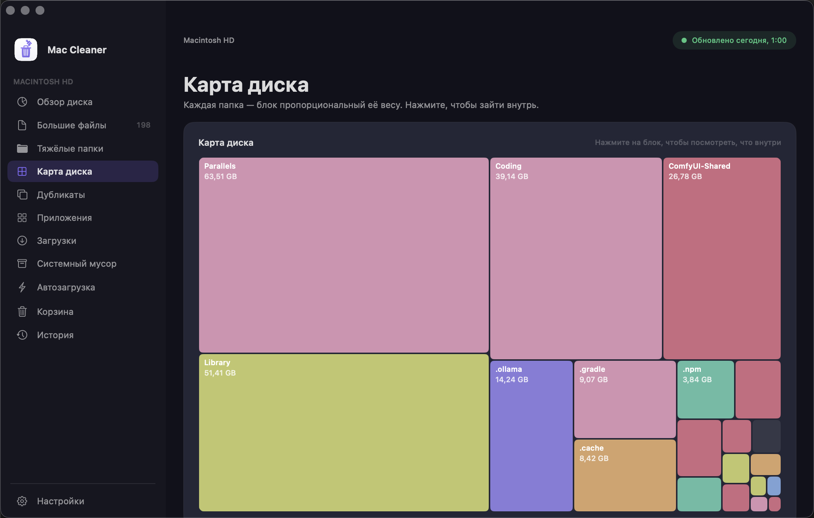
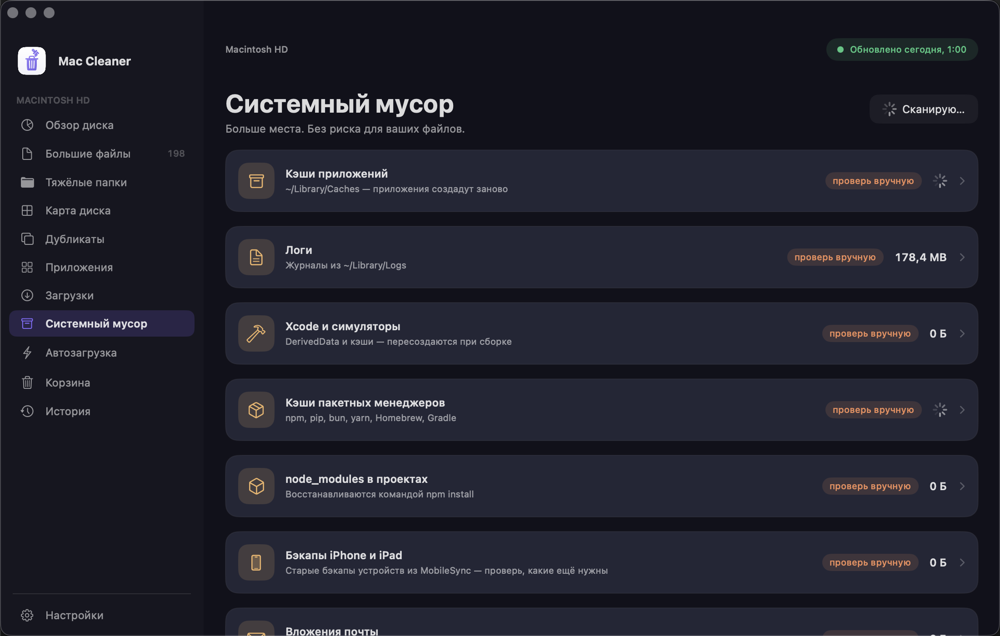

<div align="center">
  
  <h1>Mac Cleaner</h1>
  <p>Нативный очиститель диска для macOS на SwiftUI.<br>Без телеметрии, без подписок, без «ускорения Mac» — только факты и контроль.</p>

  <p>
    <a href="https://github.com/MrPacmann/MacCleaner/releases/latest"></a>
    
    
    <a href="LICENSE"></a>
  </p>

  <p><a href="README.md">English</a> · <b>Русский</b> · <a href="ROADMAP.ru.md">Roadmap</a></p>
</div>

---

## Скриншоты

<p align="center">
  
  
</p>
<p align="center">
  
  
</p>

## Возможности

- **Обзор диска** — занятое место по категориям с проваливанием в файлы каждой категории
- **Карта диска** — интерактивная treemap папок, как в DaisyDisk
- **Большие файлы и тяжёлые папки** — от 50 МБ и от 100 МБ, с поиском и сортировкой
- **Дубликаты** — точное сравнение по содержимому (SHA-256)
- **Приложения** — удаление вместе с остатками (кэши, настройки, контейнеры) + поиск «сирот» от давно удалённых программ
- **Системный мусор** — кэши, логи, Xcode/DerivedData, пакетные менеджеры, node_modules, сборки проектов (dist, .next, target, build, Pods, venv), Docker, бэкапы iPhone/iPad, вложения почты
- **Автозагрузка** — агенты пользователя, включая битые (программа уже удалена)
- **Загрузки** — файлы старше 30 дней
- **Корзина** — просмотр и очистка
- **История** — журнал очисток, график свободного места и «что выросло с прошлого сканирования»
- **Меню-бар** — свободное место на диске всегда перед глазами (отключается)
- **Быстрые команды** — действия «Начать сканирование» и «Очистить корзину» для Shortcuts и Siri
- **Автообновления** — приложение само скачивает новые версии с GitHub Releases и устанавливает их
- **Горячие клавиши** — ⌘1…⌘0 по разделам, ⌘F — поиск
- Русский и английский интерфейс, тёмная и светлая темы

## Безопасность

- Удаление — **только в Корзину** (восстановление в один клик)
- Никаких системных файлов и SIP-защищённых путей
- Всё сканирование локально, сеть используется только для проверки обновлений

## Готовая сборка

Скачайте DMG из [последнего релиза](https://github.com/MrPacmann/MacCleaner/releases/latest), откройте его и перетащите MacCleaner в папку Applications.

### Если macOS пишет «не удалось подтвердить, что файл не содержит вредоносного ПО»

Это стандартная реакция Gatekeeper на бесплатную подпись разработчика (ad-hoc) — приложение скачано из интернета и не нотаризовано Apple. Обходится так:

1. Нажмите **«Готово»** в диалоге (не «Переместить в Корзину»)
2. Откройте **Системные настройки → Конфиденциальность и безопасность**
3. Пролистайте вниз — там появится строка про MacCleaner с кнопкой **«Всё равно открыть»**
4. Подтвердите — приложение запустится, и больше macOS спрашивать не будет

Либо одной командой в Терминале после установки в «Программы»:

```bash
xattr -dr com.apple.quarantine /Applications/MacCleaner.app
```

Это нужно сделать **один раз при первой установке**. Обновления внутри приложения (Настройки → Обновления) скачиваются самим MacCleaner, поэтому устанавливаются без этого диалога.

После запуска выдайте **Полный доступ к диску** (Настройки → Разрешения внутри приложения), иначе часть папок будет недоступна для сканирования.

## Сборка из исходников

Нужны только Xcode Command Line Tools — проект собирается одним скриптом:

```bash
git clone https://github.com/MrPacmann/MacCleaner.git
cd MacCleaner
./build.sh
open build/MacCleaner.app
```

## Технологии

SwiftUI · Observation · CryptoKit · Charts · AppIntents · без внешних зависимостей · macOS 14+

## Автор

Stepan Trushin — [github.com/MrPacmann](https://github.com/MrPacmann)
